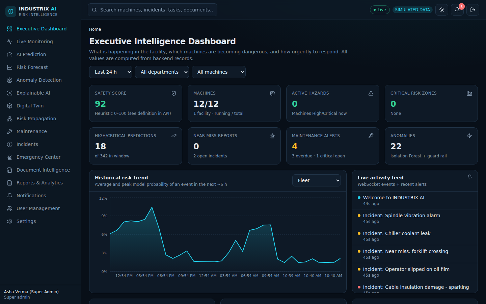
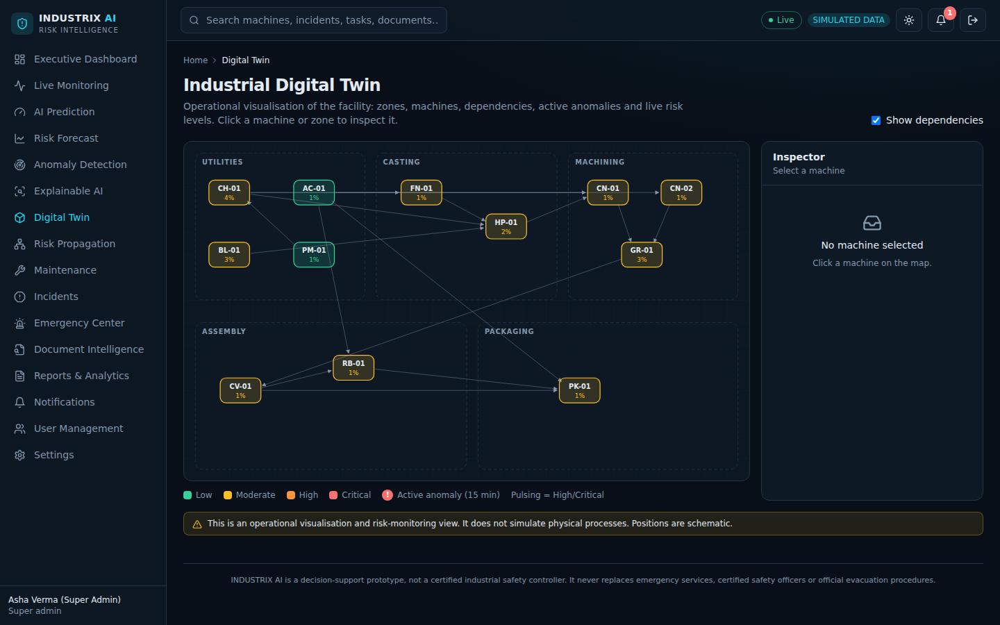
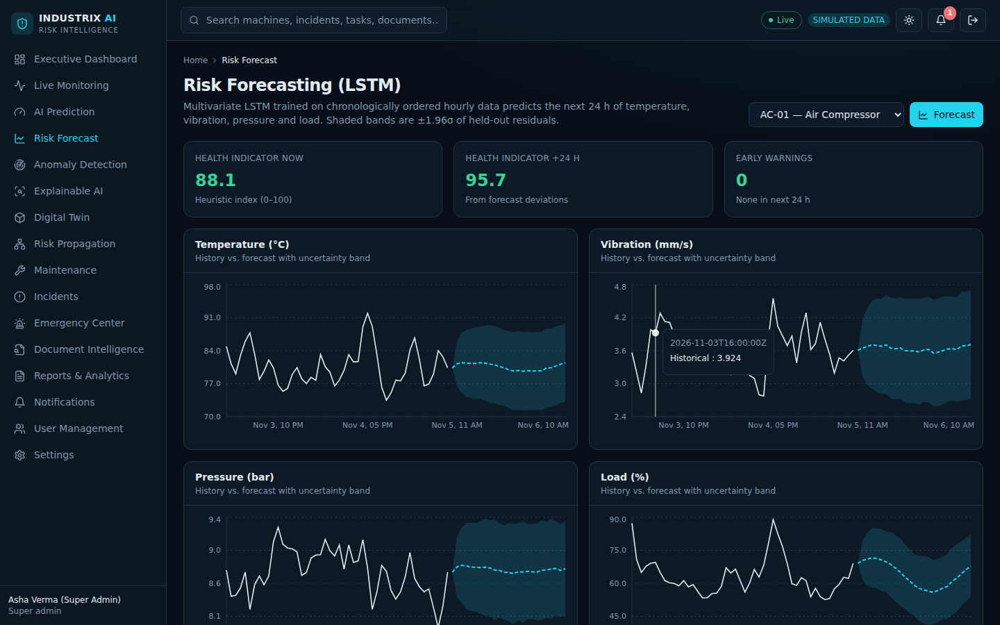

# INDUSTRIX AI — Industrial Risk Intelligence & Predictive Safety Platform

A full-stack **decision-support prototype** that analyses machine sensor streams, maintenance/inspection history and incident records to estimate accident risk, flag anomalies, forecast equipment conditions, explain predictions and support maintenance and emergency-response workflows.

> **Read this first — honesty notes**
> - All ML models are trained on **synthetic data** generated by `backend/app/ml/training/data_gen.py`. Reported metrics show that the pipeline works and is leakage-free; they are **not** real-world safety performance.
> - Sensor data comes from a **built-in simulator**. No physical hardware is connected (the UI says so everywhere).
> - This is **not a certified safety system**. It never operates machinery or contacts emergency services; recommendations require review by authorised personnel.
> - Docker/CI/cloud files are written but **not executed** by the authors. See [docs/CHECKLIST.md](docs/CHECKLIST.md) and [docs/KNOWN_LIMITATIONS.md](docs/KNOWN_LIMITATIONS.md).

## Features (all implemented; see checklist for verification level)
Executive dashboard · live monitoring with WebSocket streaming, pause/speed/fault injection · XGBoost + Random-Forest accident prediction with calibrated probabilities and configurable thresholds · LSTM 24 h forecasting with uncertainty bands and data-sufficiency warnings · Isolation-Forest anomaly detection · SHAP explanations · NLP document intelligence · risk-propagation engine over a configurable dependency graph · interactive digital twin · maintenance workflow + recommendations · incident & emergency response with PDF export · 8 CSV/PDF report types · JWT auth with 5 roles · notifications, search, audit log, dark/light themes.

## Tech stack
| Layer | Used |
|---|---|
| Frontend | React 18, TypeScript, Vite, Tailwind CSS (hand-written components), Framer Motion, Recharts, Lucide, React Router, TanStack Query, native WebSocket |
| Backend | Python 3.12, FastAPI, Pydantic v2, SQLAlchemy 2, Alembic, python-jose (JWT), bcrypt |
| ML | pandas, NumPy, scikit-learn, XGBoost, TensorFlow/Keras (LSTM), SHAP, joblib, SciPy, matplotlib, ReportLab |
| Data | SQLite (default) · PostgreSQL (supported) |
| Ops | Docker, Docker Compose, GitHub Actions |

## Quick start (verified path)
```bash
# 1. backend
python3 -m venv .venv && source .venv/bin/activate
pip install -r backend/requirements-dev.txt
cd backend
python -m app.seed --reset          # migrations + demo facility, 12 machines, 10 days of generated history
uvicorn app.main:app --port 8000    # Swagger: http://localhost:8000/docs  (simulator starts automatically)

# 2. frontend (new terminal)
cd frontend && npm install && npm run dev   # http://localhost:5173
```
Or run `./scripts/setup_local.sh` then `./scripts/run_dev.sh`.

### Development-only demo accounts
| Role | Email | Password |
|---|---|---|
| Super Admin | admin@industrix.dev | Admin@12345 |
| Safety Manager | safety.manager@industrix.dev | SafetyMgr@123 |
| Plant Manager | plant.manager@industrix.dev | PlantMgr@123 |
| Maintenance Engineer | engineer@industrix.dev | Engineer@123 |
| Safety Officer | officer@industrix.dev | Officer@123 |
**Change or delete these before any real deployment.**

### Try the live pipeline
Log in as Plant/Safety Manager or Admin → **Live Monitoring** → select `CN-01` → *Inject* `temperature_spike` → within ~15–30 s watch the risk rise, an anomaly appear (Anomalies page), a notification toast, and the machine turn amber/red on the **Digital Twin**. Use **Cascade to dependents** to see **Risk Propagation**.

## Models: train / evaluate / retrain
Trained artifacts are committed in `models/` (≈ 7 MB). To regenerate everything (≈ 2–4 min on CPU):
```bash
cd backend && python -m app.ml.training.train_all          # add --fast for a quick run, --only risk anomaly ...
python ../scripts/gen_docs.py                               # refresh docs/ML_RESULTS.md, API.md, ER_DIAGRAM.md
```
Individual stages: `app.ml.training.data_gen`, `train_risk`, `app.ml.anomaly_detection.train_anomaly`, `app.ml.forecasting.lstm`, `app.ml.nlp.pipeline`. Methodology: [docs/ML_METHODOLOGY.md](docs/ML_METHODOLOGY.md) · results: [docs/ML_RESULTS.md](docs/ML_RESULTS.md).

## Tests
```bash
cd backend && python -m pytest -q          # 45 tests: auth, RBAC, dashboard, machines, ingestion, prediction, anomaly, forecast, maintenance, incidents, reports, NLP, ML leakage...
cd frontend && npm test                    # 13 Vitest + React Testing Library tests
# Browser E2E (needs API on :8000 and `npm run dev` on :5173):
pip install playwright pytest && playwright install chromium && pytest e2e -q     # 10 tests; SHOTS=1 also writes docs/screenshots
```

## Project layout
```
backend/app/{api,core,models,schemas,services,ml,simulator,reports}   backend/alembic   backend/tests
frontend/src/{pages,components,layouts,contexts,hooks,services,utils,test}
models/   data/sample/   docs/   scripts/   e2e/   docker-compose.yml   .github/workflows/ci.yml
```
Docs: [Architecture](docs/ARCHITECTURE.md) · [ER diagram](docs/ER_DIAGRAM.md) · [API](docs/API.md) · [Data dictionary](docs/DATA_DICTIONARY.md) · [Deployment](docs/DEPLOYMENT.md) · [Checklist](docs/CHECKLIST.md) · [Limitations](docs/KNOWN_LIMITATIONS.md)

## Screenshots (real, captured by the E2E run)



More in `docs/screenshots/` (all 16 pages + mobile light mode).

## Future scope
Real incident-labelled datasets and external validation · OPC-UA/MQTT connectors · Redis-backed rate limiting/queues · survival/time-to-failure models · OCR for scanned reports · per-facility tenancy · calibrated cost-sensitive thresholds per department.

## License
MIT — see [LICENSE](LICENSE).
