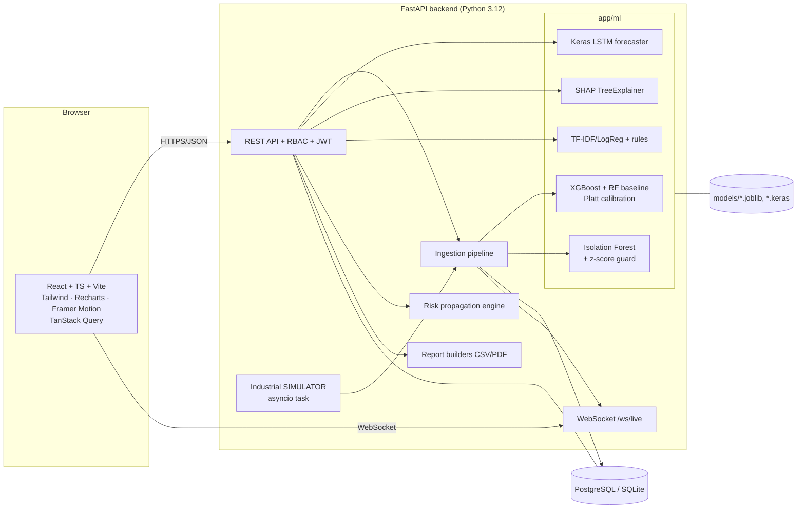

# Architecture

## Data flow for one sensor reading
1. Simulator tick (or `POST /api/sensors/readings`) -> `services/ingest.py` stores a `sensor_readings` row (tagged `data_source`).
2. `services/risk.py` builds the 13 model features: machine-relative deviations (σ vs the machine's own baseline), 3-hour trend, plus context from the DB (maintenance overdue days, incidents in 90 days, latest inspection, equipment age).
3. `ml/inference/risk.py` -> calibrated XGBoost probability -> category via active thresholds -> data-quality checks (missing inputs, out-of-distribution, stale data, borderline).
4. `ml/anomaly_detection/detector.py` (Isolation Forest + z-score guard) -> optional `anomaly_records` row.
5. Notifications are created with a cool-down; the event batch is pushed to all WebSocket clients; the UI merges live points into charts.

## Design decisions
- **Machine-relative features**: one global model serves machines whose units differ (6 bar vs 140 bar).
- **Predictions are throttled** (≥10 s per machine unless the category changes) to bound DB growth; readings are stored every tick.
- **SHAP is computed on demand** (and cached in `risk_predictions.contributions`) to keep ingestion fast.
- **Propagation** (see `services/propagation.py` docstring) is an explicit, documented heuristic over the configured dependency graph.
- **Time bucketing** is done in SQL for both SQLite and PostgreSQL (`api/deps.py::bucket_expr`).
- **No automated physical actions**: the system only recommends and records; humans confirm.
